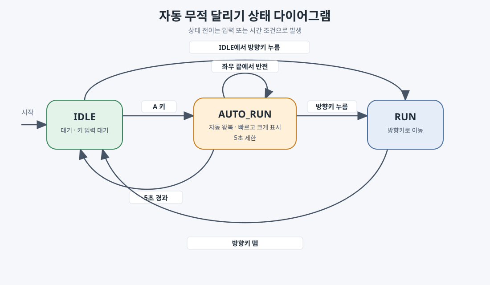

# 자동 무적 달리기 PRD

## 개요
소년이 대기(`IDLE`) 중 `A` 키를 누르면 5초 동안 자동으로 좌우를 달리는 무적 달리기(`AUTO_RUN`)를 시작한다. 이 상태에서는 키 입력 없이 움직이며, 일반 달리기보다 빠르고 크게 표시된다.

## 사용자 요구사항
- `IDLE` 상태에서 `A` 키를 누르면 `AUTO_RUN` 상태로 전환한다.
- `AUTO_RUN` 상태에서는 입력을 반복하지 않아도 소년이 계속 움직인다.
- 자동 달리기 속도는 기존 `RUN` 속도보다 빠르다.
- 소년은 자동 달리기 중 확대 표시된다.
- 소년은 화면 밖으로 나가지 않고, 화면 좌우 끝에 도달하면 즉시 이동 방향을 바꾼다.
- `AUTO_RUN` 진입 후 5초가 지나면 `IDLE` 상태로 돌아간다.
- `AUTO_RUN` 상태에서 왼쪽 또는 오른쪽 방향키를 누르면 자동 달리기를 취소하고, 누른 방향으로 기존 `RUN`을 시작한다.
- 기존 `IDLE`, `RUN` 동작은 유지한다.

## 상태 및 입력 동작
| 현재 상태 | 입력/조건 | 다음 상태 및 동작 |
| --- | --- | --- |
| `IDLE` | `A` 키 누름 | `AUTO_RUN` 진입, 타이머 시작, 현재 바라보는 방향으로 자동 이동 |
| `IDLE` | 왼쪽/오른쪽 방향키 누름 | 누른 방향의 기존 `RUN` 진입 |
| `AUTO_RUN` | 매 프레임 갱신 | 빠르게 이동하고 애니메이션 재생, 화면 좌우 경계에서 방향 반전 |
| `AUTO_RUN` | 5초 경과 | `IDLE` 진입 및 대기 타이머 초기화 |
| `AUTO_RUN` | 왼쪽 방향키 누름 | 자동 이동 취소, 왼쪽 방향의 기존 `RUN` 진입 |
| `AUTO_RUN` | 오른쪽 방향키 누름 | 자동 이동 취소, 오른쪽 방향의 기존 `RUN` 진입 |
| `RUN` | 방향키 뗌 | 기존 동작대로 `IDLE` 진입 |

## 경계 및 표시 기준
- 캔버스 크기는 기존 게임의 800×600 좌표계를 기준으로 한다.
- 자동 달리기의 좌우 이동 한계는 확대된 소년 스프라이트가 캔버스 안에 완전히 보이도록 스프라이트 반폭을 반영한다.
- 확대 렌더링 크기는 기존 100×100 픽셀보다 크게 설정하며, 기존 스프라이트 프레임과 방향별 애니메이션을 사용한다.
- 일반 `RUN`의 이동 속도와 렌더링 크기는 변경하지 않는다.

## 인수 기준
1. `IDLE`에서 `A` 키를 누르면 자동 달리기가 시작되고, 누른 채 유지할 필요가 없다.
2. 자동 달리기 중 소년의 좌우 위치는 확대된 스프라이트의 절반 너비를 고려한 화면 안쪽 범위를 벗어나지 않는다.
3. 좌우 경계에 도달하면 다음 이동 갱신부터 반대 방향으로 진행한다.
4. 자동 달리기의 이동 속도와 그려지는 크기는 일반 `RUN`보다 크다.
5. 자동 달리기 시작 후 5초가 지나면 `IDLE`로 전환된다.
6. 5초가 되기 전에 방향키를 누르면 해당 방향의 일반 `RUN`으로 즉시 전환되며, 이후 기존 방향키 입력 및 해제 동작을 따른다.
7. 일반 `IDLE`, `RUN`의 기존 입력 및 애니메이션 동작은 유지된다.

## 범위 제외
- 무적 효과의 충돌 판정, 점수, 적 또는 장애물 시스템은 현재 프로젝트에 없으므로 추가하지 않는다. `AUTO_RUN`은 요청된 자동 이동 모드로 구현한다.
- 설정 화면이나 자동 달리기 속도/시간 조절 기능은 추가하지 않는다.
